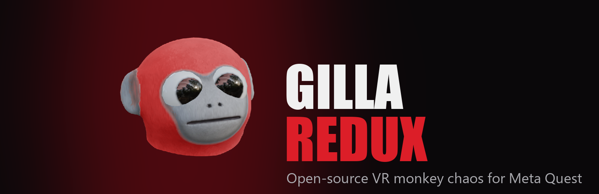
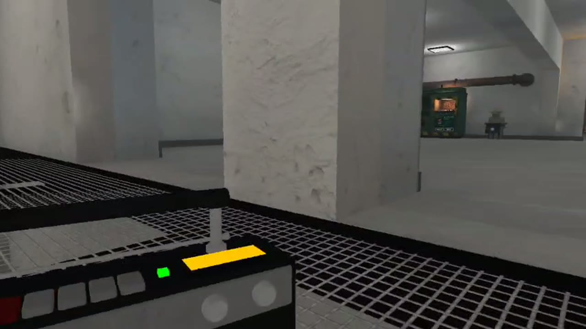
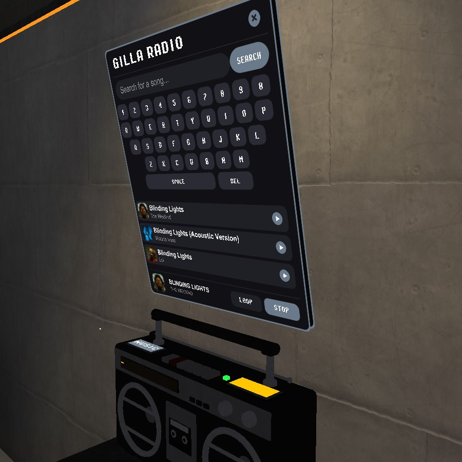

<div align="center">



<br>

**A fan-made, open-source rebuild of Gilla, the VR monkey game, for Meta Quest.**
<br>
Climb, grab and brawl in a shared world full of monsters, crushing doors and loose body parts.

<br>


[**Features**](#-features) · [**Screenshots**](#-screenshots) · [**Getting started**](#-getting-started) · [**Online setup**](#-online-setup) · [**Project layout**](#-project-layout) · [**Contributing**](#-contributing)

</div>

---

## 🦍 About

Gilla Redux started as a learning project: take apart how a Quest VR game works and rebuild it as a project anyone can open in Unity. It grew into a playable game, with the original maps, lighting and models plus new features of its own.

> [!NOTE]
> This is an **unofficial fan project**. It is not affiliated with or endorsed by the original Gilla developers.

## ✨ Features

<table>
<tr>
<td width="50%" valign="top">

### 👹 Monsters
Monsters hunt, grab, punch and tear players apart, and are synced over the network for everyone. Owners can become any monster at any time.

### 🎮 Game modes
**Be The Monster** and **Don't Splash**, plus the classic shared world.

### 🦴 Physical everything
Gold bricks, bolts and **torn-off body parts** can be grabbed and thrown. A crushing door cuts your arm off; you only die if it gets your head.

</td>
<td width="50%" valign="top">

### 📻 The jukebox
Carry the boombox anywhere. Press **MUSIC** and a 3D screen rises out of it, with a search bar, a laser pointer, album covers, **LOOP** and **STOP**. The song you pick plays for the whole room, and its name scrolls across the front display.

### 🛒 Shop and cosmetics
Player colours, a size menu and skins, with purchases that show for everyone.

### 🖥️ Computer and admin
An in-game computer for settings and music. Owners get an admin menu to ban, grant items and debug, all handled on the server.

</td>
</tr>
</table>

## 📸 Screenshots

<div align="center">

 

<sub><b>Left:</b> recorded on a Quest 3S. <b>Right:</b> the jukebox's music screen.</sub>

</div>

## 🚀 Getting started

**You need:**
- Unity **6000.3.27f1**, with **Android Build Support** if you want to build for Quest
- A Meta Quest headset (optional: you can also play in the editor with mouse and keyboard)

**Steps:**

```bash
git clone https://github.com/stripesvr/Gilla-Open-Source.git
```

1. In **Unity Hub**, choose **Add → Add project from disk** and pick the folder. The first import takes a while.
2. Open `Assets/Scenes/Loading.unity`.
3. Press **▶ Play**.

> [!TIP]
> To build for Quest, open **File → Build Profiles**, switch to **Android**, and use **Build And Run** with your headset plugged in and developer mode turned on.

## 🌐 Online setup

The private keys and backend aren't included, so online play, saving and accounts won't connect until you add your own free IDs:

| What | Where it goes | Get one |
|------|---------------|---------|
| Photon **Fusion** app ID | `Assets/Resources/PhotonAppSettings.asset` → `AppIdFusion` | [Photon dashboard](https://dashboard.photonengine.com) |
| Photon **Voice** app ID | `Assets/Resources/PhotonAppSettings.asset` → `AppIdVoice` | [Photon dashboard](https://dashboard.photonengine.com) |
| PlayFab **title ID** | `Assets/Resources/PlayFabSharedSettings.asset` → `TitleId` | [PlayFab](https://playfab.com) |

## 🗂️ Project layout

```text
Assets/
├── Scenes/            Loading and Main scenes
├── Scripts/           All game code (players, monsters, modes, shop, jukebox, networking)
├── Editor/            Editor tools and batch tests
├── Shader/            Custom URP shaders (fur, glass, water, dot effects)
├── GameObject/        Prefabs: players, monsters, cosmetics, items
├── Mesh/  Material/  Texture2D/  AudioClip/  AnimationClip/
├── Photon/            Photon Fusion and Voice SDKs
└── PlayFabSDK/        PlayFab SDK
```

## 🐛 Known issues

- Some textures and shaders are approximations of the original look.
- Songs from the main search play as 30-second clips.
- Meta usernames need your own Meta App ID.
- It's a hobby project, so expect bugs. Reports are very welcome.

## 🤝 Contributing

Bug reports, fixes and ideas are all welcome.

1. Fork the repo and create a branch.
2. Make your change and test it in the editor.
3. Open a pull request describing what you changed and why.

<div align="center">

<br>

Made with 🦍 and too many late nights by **[stripesvr](https://github.com/stripesvr)**

If you like it, a ⭐ helps a lot!

</div>
