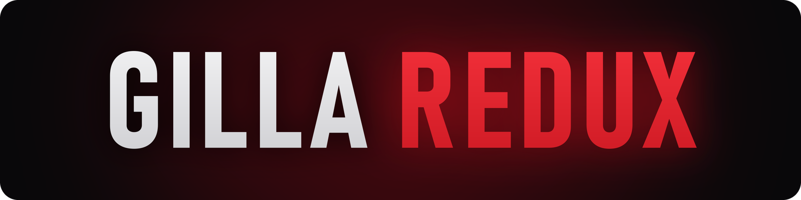

  

A fan-made, open-source rebuild of Gilla, the VR monkey game for Meta Quest. Built in Unity 6 with Photon Fusion.

> Unofficial fan project. Not affiliated with or endorsed by the original Gilla developers.

## $\color{#E0262F}{\textsf{The game}}$

- $\color{#E0262F}{\textsf{Monsters}}$ that hunt, grab and tear players apart, and you can play as one
- $\color{#E0262F}{\textsf{Game modes}}$, including Be The Monster and Don't Splash
- $\color{#E0262F}{\textsf{Gold{,} bolts and torn-off body parts}}$ you can grab and throw
- $\color{#E0262F}{\textsf{Doors}}$ that crush your arms off
- $\color{#E0262F}{\textsf{A shop}}$ with colours, cosmetics and a size menu
- $\color{#E0262F}{\textsf{An in-game computer}}$
- $\color{#E0262F}{\textsf{A jukebox}}$ you can carry around that plays songs for the whole room

## $\color{#E0262F}{\textsf{Getting started}}$

1. Install Unity **6000.3.27f1**, with Android Build Support if you want to build for Quest.
2. Clone this repo and add the folder in Unity Hub. The first import takes a while.
3. Open `Assets/Scenes/Loading.unity` and press Play.

## $\color{#E0262F}{\textsf{Online setup}}$

The private keys and backend aren't included. To play online, add your own free IDs:

| Setting | File |
|---------|------|
| Photon Fusion app ID | `Assets/Resources/PhotonAppSettings.asset` (`AppIdFusion`) |
| Photon Voice app ID | `Assets/Resources/PhotonAppSettings.asset` (`AppIdVoice`) |
| PlayFab title ID | `Assets/Resources/PlayFabSharedSettings.asset` (`TitleId`) |

## $\color{#E0262F}{\textsf{Notes}}$

This is a hobby project, so it's not perfect. Some textures and shaders are approximations of the original, and some systems are still rough. Bug reports, fixes and ideas are welcome.
